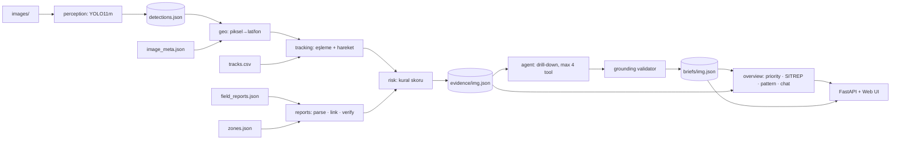

# BaseGuard Mimarisi

Aşama 2: Saha raporu destekli LLM agent. Ekip 6 kişi, süre 15–20 saat (plan 18 saat üzerine kurulu). Stack Python: FastAPI, Ultralytics ve OpenAI SDK üzerinden GLM-5.3-Flash.

## 1. Temel ilke
**Kod ölçer, LLM karar verir ve açıklar.**
- Mesafe, hız, eşleşme ve rapor–araç bağlantısı deterministik Python modüllerinde hesaplanır. Her görüntü için tek bir `evidence.json` üretilir.
- GLM agent bu kanıttan yola çıkar ve sadece belirsizlik olduğunda tool çağırır (en fazla 4 adım).
- Agent, kanıt ID'lerine bağlı yapılandırılmış bir brief yazar. Brief'teki ID'ler ve sayılar kodla doğrulanır.
- Model eğitimi yoktur. Tek eğitilmiş model Aşama 1'deki YOLO'dur (model C). Track uç noktaları yalnızca kalibrasyon için zayıf etiket olarak kullanılır.

Neden: GLM her çağrıda ~10–15 sn reasoning yapıyor. Uzun bir tool döngüsü canlı demoda dakikalar sürer. Sayıların koddan gelmesi halüsinasyonu önler ve jüriye iddiaların dayanağı gösterilebilir.

## 2. Veri akışı


## 3. Katmanlar
| Paket | Sorumluluk | Sahip |
|---|---|---|
| `domain` | pydantic sözleşmeleri. Başka hiçbir katmana bağımlı değil | R4 + herkes (H2'de dondurulur) |
| `io` | Dosya okuma, cache, `.env` ayarları | R4 |
| `geo` | Projection, haversine, bearing, footprint, bölge bulma | R2 |
| `perception` | YOLO wrapper, crop util | R1 |
| `tracking` | Eşleme (gating + Hungarian), hareket özellikleri | R2 |
| `reports` | Parser, claim tipleri, linker, verifier | R3 |
| `risk` | Kural tablosu, skor | R4 |
| `evidence` | Pipeline → `evidence.json` | R4 |
| `agent` | GLM client, tools, prompt, döngü, şema, validator | R5 |
| `overview` | Priority queue, koordineli yaklaşma, rapor defteri, SITREP, chat | R4 / R5 |
| `api` + `web/` | FastAPI (SSE) + tek sayfa Leaflet UI | R6 |

Bağımlılık yönü: `api → services → agent / evidence → geo, tracking, reports, risk → domain`. LLM'e ve dosyalara yalnızca `agent` ve `io` katmanları erişir.

## 4. Veri sözleşmeleri (H2'de dondurulur)
2 görüntü için elle yazılmış mock evidence ve mock brief repoya konur. Agent ve UI ekipleri gerçek pipeline'ı beklemeden bunlarla başlar.

```jsonc
// artifacts/detections.json  (perception → geo)
{ "img_000860": [ { "det_id": "D1", "cls": "truck", "conf": 0.71,
    "bbox_xywh": [610, 380, 60, 28], "center_px": [640, 394] } ] }
```

```jsonc
// artifacts/evidence/<image_id>.json  (pipeline → agent)
{ "image_id": "img_000860", "capture_time": "14:10", "size_px": [960, 540],
  "footprint": { "center": [39.92535, 32.87143], "dist_to_base_m": 1610, "zone": "Dogu Yolu", "gsd_cm": 12.5 },
  "vehicles": [{ "det_id": "D1", "cls": "truck", "conf": 0.71, "lat": 39.92531, "lon": 32.87140,
      "track_id": "T0187", "match_dist_m": 2.5,
      "motion": { "speed_med_ms": 7.9, "speed_last30_ms": 9.1, "heading_deg": 212,
                  "dist_base_m": { "t-120": 7400, "t-60": 5800, "t0": 3000 },
                  "approach_rate_ms": 0.8, "stopped_min": 10, "state": "yaklasiyor" } }],
  "unmatched_detections": ["D4"],
  "unmatched_tracks": [{ "track_id": "T0190", "inside_footprint": true }],
  "reports": [{ "report_id": "R42", "time": "12:40", "source": "third_party", "data": "<ham metin>",
      "claim": { "type": "gorulme", "vehicle": "truck", "count": 1 },
      "dist_m": 35, "minutes_before": 90, "linked_track": "T0187", "check": "uyumlu" }],
  "rules_fired": [{ "rule_id": "K2", "name": "2 km içinde yaklaşan ağır araç", "points": 2, "refs": ["D1", "T0187"] }],
  "base_score": 4, "base_level": "ORTA" }
```

```jsonc
// artifacts/briefs/<image_id>.json  (agent → UI, overview)
{ "image_id": "img_000860", "level": "YUKSEK", "base_level": "ORTA",
  "level_change_reason": "...",
  "findings": [{ "claim": "...", "evidence_ids": ["D1", "T0187", "K2"], "confidence": "yuksek" }],
  "report_assessments": [{ "report_id": "R42", "verdict": "celiskili", "why": "..." }],
  "summary_tr": "...",
  "tool_log": [{ "tool": "inspect_crop", "args": {}, "why": "..." }] }
```
ID önekleri: `D` tespit, `T` track, `R` rapor, `K` kural. Seviyeler: `DUSUK | ORTA | YUKSEK`.

## 5. Agent ve backend
**LLM istemcisi.** GLM'e giden tek kapı. OpenAI SDK kullanılır, yalnızca base URL, key ve model adı değişir. Bu katman şunları üstlenir: retry, aynı anda en fazla 4 istek, cömert `max_tokens` (reasoning de bu limitten harcar), `thinking` parametresi yok, harcama logu (`/key/info`). Bir arayüzün arkasında durur; test ve offline demo için sahte bir istemciyle değiştirilebilir.

**Agent döngüsü (görüntü başına).**
1. Evidence özeti modele gönderilir.
2. Model belirsizlik görürse tool ister: `inspect_crop(det_id)` (vision ile renk ve tip kontrolü), `get_track_detail(track_id)`, `get_report(report_id)`, `list_nearby_reports(radius_m, window_min)`.
3. Tool'u bizim kod çalıştırır, sonucu mesaj listesine ekler.
4. Model brief'i `submit_brief` tool'u ile teslim eder. Böylece çıktı her zaman aynı şemada gelir.
5. Validator brief'teki ID'lerin ve sayıların evidence ile tutup tutmadığını kontrol eder. Hata varsa hata mesajıyla bir kez yeniden denenir.

Döngünün üst sınırı 5 adımdır. Rapor metinleri modele sadece `data` alanında verilir; sistem prompt'u rapor içindeki talimatları uygulamamasını söyler. LLM baz seviyeyi en fazla bir kademe değiştirebilir ve bunun gerekçesini yazmak zorundadır.

**Servisler.** "Görüntüyü analiz et" ve "üs geneli özet" gibi iş akışları. Önce cache'e bakar, sonuç yoksa agent'ı çalıştırır.

**FastAPI uçları (taslak).** `GET /api/images`, `GET /api/images/{id}` (meta, tespitler, evidence), `GET /api/images/{id}/analyze/stream?mode=cached|live|replay` (SSE), `GET /api/overview`, `POST /api/overview/sitrep`, `POST /api/chat`, `GET /api/health` (GLM erişimi ve harcama).

**Çalışma modları.**
- `cached`: hazır brief anında gösterilir.
- `live`: agent gerçekten çalışır; her adım SSE ile ekrana akar.
- `replay`: kaydedilmiş bir canlı koşu aynı adımlarla yeniden oynatılır. Sahnede API ya da internet sorun çıkarırsa demo bununla devam eder.

**İlk iş (30 dk API testi).** GLM için şunlar doğrulanmalı. `submit_brief` yaklaşımı bu testin sonucuna göre kesinleşir.
- Paralel tool call destekleniyor mu?
- `response_format` ile JSON şema zorlaması çalışıyor mu?
- Görüntü girdisi ve tool call aynı çağrıda kullanılabiliyor mu?
- `reasoning_content` mesaj geçmişine geri gönderildiğinde sorun çıkıyor mu?

## 6. Başlangıç kural tablosu (veriyle ayarlanacak)
- Üsse 2 km içinde ve yaklaşan araç (yaklaşma hızı > 0,5 m/s): +2. Araç ağırsa (truck/bus) ayrıca +1.
- "Dost / planlı ikmal" iddiası tespitle çelişiyor (tip, sayı ya da yön): +3. Uyumluysa −1; bu kural riski asla sıfırlamaz.
- Rapor iddiası çelişkili (sayı, hareketsizlik): +1, rapor "çelişkili" olarak işaretlenir.
- Footprint içinde biten ama hiçbir tespitle eşleşmeyen track: +1 (kaçırılmış tespit ihtimali).
- Uzun süre duran ağır araç, hakkında rapor yok: +1.
- Seviyeler: 0–1 DÜŞÜK, 2–3 ORTA, 4+ YÜKSEK.

## 7. Ekip ve zaman çizelgesi
| Rol | Teslim | Hedef saat |
|---|---|---|
| R1 Perception | `detections.json`, kalibrasyon (track uçlarıyla recall), crop util | H5 / H8 |
| R2 Geo + Tracking | `geo/`, `tracking/` + testler (PDF örneği: 39.94439, 32.86350) | H8 |
| R3 Reports | `reports/` + 137 raporun sınıflanmış tablosu | H9 |
| R4 Risk + Evidence | 40 adet `evidence.json`, overview | H9 / H16 |
| R5 Agent (Kemal) | `agent/`, 40 brief, SITREP, chat | H12 / H16 |
| R6 API + UI + Demo | `api/`, `web/`, demo senaryosu, sunum | H12 / H16 |

Kilometre taşları:
- **H2:** sözleşmeler ve mock dosyalar repoda.
- **M1 (H8):** tek görüntü uçtan uca çalışıyor.
- **M2 (H12):** 40 brief cache'te, çekirdek donduruldu.
- **M3 (H16):** kod donduruldu. Kalan süre sunum, iki prova ve yedek video.

## 8. Riskler
- **Detektör domain shift (yüksek).** Görüntüler kuşbakışı ve GSD 11–20 cm, yani nesneler küçük. Recall 6. saatte ölçülür. imgsz 1536 ve tiling denenir. Son çare olarak pseudo-label ile kısa bir fine-tune yapılır, o da kritik yolu bloklamadan.
- **Entegrasyon gecikmesi (yüksek).** H2'de sözleşme ve mock hazır olur, R4 entegrasyonun sahibidir.
- **GLM gecikmesi, 429 hataları, bütçe (orta).** 4'lük semaphore, backoff, adım limiti ve cache ile yönetilir.
- **Demo sırasında ağ sorunu (orta).** Cache ve replay modları devreye girer, yedek ekran kaydı hazır tutulur.
- **Raporlardaki tuzaklar ve prompt injection (orta).** "Dost" iddiası riski asla tek başına sıfırlamaz. Rapor metni yalnızca veri olarak işlenir.

## 9. Çalışma kuralları
- `main` korumalıdır. Herkes `feat/<modül>` dalında çalışır, PR'lar küçük tutulur.
- Sözleşme değişikliği sadece `domain/` üzerinden ve ekibe duyurularak yapılır.
- API key yalnızca `.env` dosyasında durur; repoya ve yarışma verisine (`data/`) hiçbir şekilde commit edilmez.
- Her modülde en az bir gerçek örnek testi (`pytest`) bulunur. Kod `ruff` ve `black` ile formatlanır, type hint zorunludur.
- Her 3 saatte bir 10 dakikalık senkron yapılır.

## 10. Bonus: üs geneli durum resmi (H12 sonrası)
1. **Durum haritası ve zaman kaydırıcı:** 40 görüntünün footprint'i risk renginde, track'ler ok olarak. (R6 + R2)
2. **Öncelik kuyruğu:** operatörün önce bakması gereken durumlar. (R4)
3. **Vardiya raporu (SITREP):** 40 brief'ten tek LLM çağrısıyla. (R5)
4. **Soru-cevap:** brief özetleri context'te, sayılar `query_alerts` gibi tool'larla koddan. (R5)
5. **Koordineli yaklaşma kuralı:** 1 saat içinde aynı yön sektöründen 3 ya da daha fazla ağır araç. (R1 / R4)
6. **Rapor güvenilirlik defteri:** kaynak bazında uyumlu / çelişkili / ilgisiz dağılımı. (R3)

Görsel sürüm: https://claude.ai/artifact/5LebufiDjKzxTJDk3doqyD
